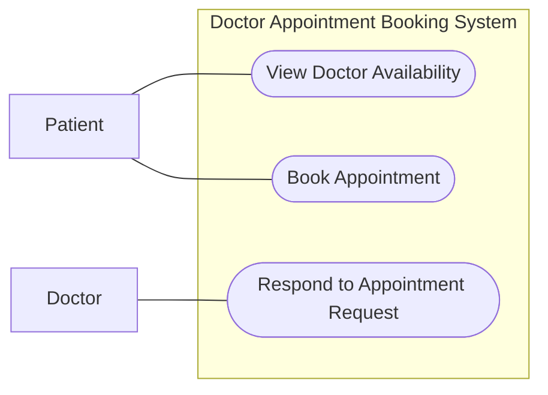

# P2 - Use Cases

## Project: Doctor Appointment Booking System

### Actors
- Patient
- Doctor

## UC1 - View Doctor Availability

**Primary Actor:** Patient

**Related Requirement:** R1

**Precondition:** The doctor has available time slots.

**Main Flow:**
1. The patient selects a doctor.
2. The system retrieves the doctor's available days and times.
3. The system displays the available time slots.

**Alternative Flow:**
- If no time slots are available, the system displays a message indicating that no appointments are available.

**Postcondition:** The patient can view the doctor's availability.

## UC2 - Book Appointment

**Primary Actor:** Patient

**Related Requirements:** R2, R4

**Preconditions:**
- The selected time slot is available.
- The patient has fewer than 3 upcoming appointments.

**Main Flow:**
1. The patient selects an available time slot.
2. The system checks the number of upcoming appointments.
3. The system verifies that the selected time slot is available.
4. The system creates an appointment request with Pending status.
5. The system confirms that the request was submitted.

**Alternative Flow:**
- If the patient already has 3 upcoming appointments, the system rejects the new booking request.
- If the selected time slot is unavailable, the system asks the patient to choose another time slot.

**Postcondition:** A pending appointment request is created.

## UC3 - Respond to Appointment Request

**Primary Actor:** Doctor

**Related Requirement:** R3

**Precondition:** A pending appointment request exists.

**Main Flow:**
1. The doctor views pending appointment requests.
2. The doctor selects a request.
3. The doctor accepts the request.
4. The system updates the appointment status to Accepted.
5. The system displays the updated status.

**Alternative Flow:**
- The doctor declines the request.
- The system updates the appointment status to Declined.

**Postcondition:** The appointment request is accepted or declined.

## P3 - Use Case Diagram

## Requirement Traceability

| Requirement | Use Case |
|---|---|
| R1 | UC1 - View Doctor Availability |
| R2 | UC2 - Book Appointment |
| R3 | UC3 - Respond to Appointment Request |
| R4 | UC2 - Check Appointment Limit |

## Non-Functional Constraints

- R5: Patient medical data must be accessible only to authorized staff.
- R6: Available appointment times must be displayed within 2 seconds.
- R7: The application must be usable on mobile phone screens.

## Project Constraint

N = 3
