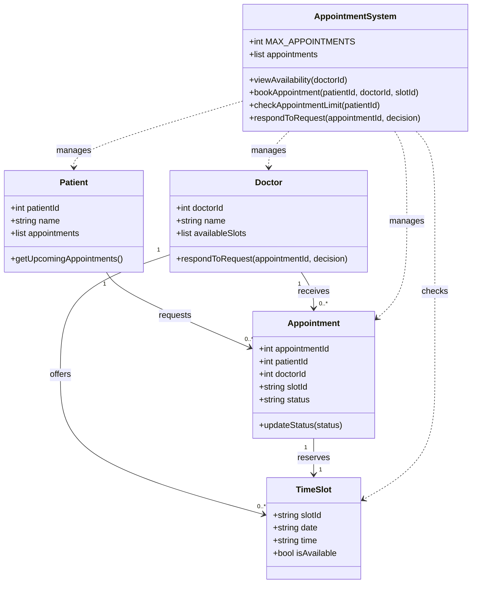

# P5 - Class Diagram

## Project: Doctor Appointment Booking System

This class diagram is based on the five selected classes from P4.

## Class Responsibilities

| Class | Responsibility |
|---|---|
| Patient | Stores patient information and upcoming appointments. |
| Doctor | Manages available slots and responds to appointment requests. |
| Appointment | Stores booking information and its current status. |
| TimeSlot | Represents a date and time available for booking. |
| AppointmentSystem | Coordinates bookings, checks availability, and enforces N = 3. |

## Business Rules

- A patient can have at most 3 upcoming appointments (N = 3).
- A patient can request an appointment only for an available time slot.
- A doctor can accept or decline an appointment request.
- Appointment status can be Pending, Accepted, or Declined.
- Patient medical data must be accessible only to authorized staff (R5).
- Available appointment times should be displayed within 2 seconds (R6).
- The application should support mobile phone screens (R7).
