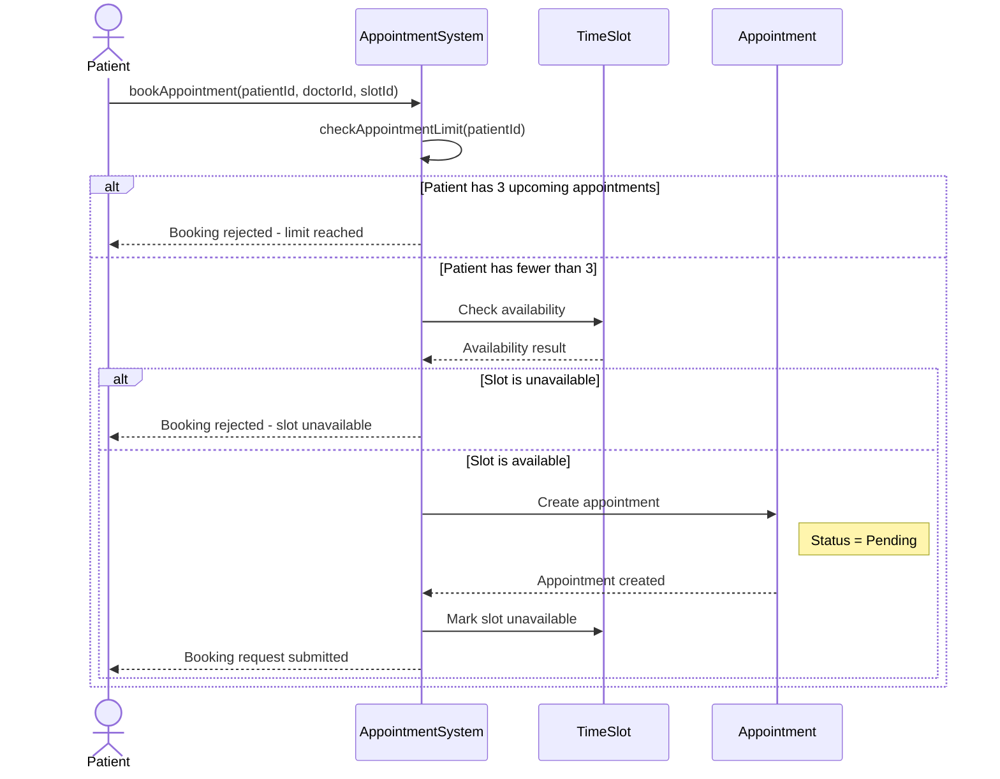

# P6 - Sequence Diagram

## Project: Doctor Appointment Booking System

### Use Case: UC2 - Book Appointment

This sequence diagram illustrates how a patient books an appointment, including the maximum appointment limit (N = 3) and time slot availability.

## Sequence Description

1. The patient requests an appointment with a doctor for a selected time slot.
2. AppointmentSystem checks the number of upcoming appointments for the patient.
3. If the patient already has 3 upcoming appointments, the request is rejected.
4. Otherwise, AppointmentSystem checks whether the selected TimeSlot is available.
5. If the time slot is unavailable, the booking request is rejected.
6. If the time slot is available, an Appointment is created with status Pending.
7. The selected time slot is marked unavailable to prevent duplicate bookings.
8. The system confirms that the booking request was submitted.

## Related Requirements

| Requirement | Description |
|---|---|
| R1 | Patients can view available doctor times. |
| R2 | Patients can book an available appointment. |
| R4 | Patients can have at most N = 3 upcoming appointments. |

## Related Classes

- Patient
- AppointmentSystem
- TimeSlot
- Appointment

The Doctor is identified through doctorId and is associated with the selected time slot and appointment.
